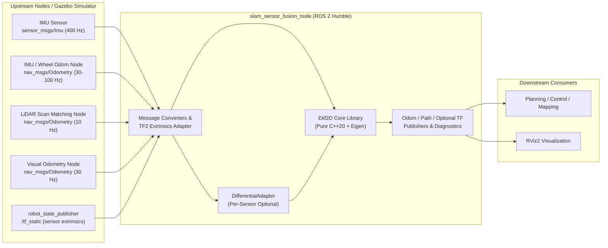

# System Architecture Overview — Shell Autonomous Car SLAM Sensor Fusion

## 1. Purpose & Big Picture

This repository implements the **SLAM sensor fusion subsystem** for the Shell Urban Concept autonomous vehicle running on **ROS 2 Humble** and simulated in **Ignition/Gazebo** (`shell_urban_simulator`).

The sensor fusion node combines asynchronous, multi-rate state estimates from three upstream perception/odometry teams into a single, smooth, covariance-tracked vehicle state estimate (`nav_msgs/msg/Odometry` + optional TF broadcast and RViz trajectory):

1. **IMU & Wheel Odometry** (high-rate motion prediction & velocity/inertial updates).
2. **LiDAR Scan Matching** (medium-rate geometric pose/relative-motion updates from the 32-layer Velodyne-style LiDAR).
3. **Visual Odometry** (medium-rate pose/relative-motion updates from the ZED RGB-D/stereo camera).

Because upstream teammate nodes are developed concurrently, this architecture decouples the **pure C++/Eigen estimation core** from **ROS 2 middleware adapters** and exposes all topic names, frame IDs, sensor modes, and noise parameters via YAML configuration.

---

## 2. System Data-Flow Diagram

---

## 3. Verified Simulator & Vehicle Baseline (`shell_urban_simulator`)

Direct inspection of `shell_urban_simulator` (`robot.sdf`, `depot.sdf`, `track/meshes/track.stl`, `gz_bridge.yaml`, `gz_simulator_launch.py`) establishes the following physical and middleware baseline:

### 3.1 Track Geometry (2D Planar Justification)
- Mesh inspection of `track/meshes/track.stl` (17,956 triangles) shows all vertices lie on three horizontal planes: road surface at $z = 0.25\,\text{m}$, curbs at $z = 0.75\,\text{m}$, and walls/barriers at $z = 1.75\,\text{m}$.
- Because the driving surface is strictly flat with zero slopes or banking, a **2D planar `SE(2)` state estimator** is sufficient and optimal for the initial delivery.

### 3.2 Vehicle Kinematics
- **Type**: 4-wheel Ackermann-steered, rear-wheel-drive urban concept vehicle (`ignition::gazebo::systems::AckermannSteering`).
- **Parameters (`robot.sdf`)**: wheelbase $L = 1.8\,\text{m}$, wheel separation $1.0\,\text{m}$, wheel radius $0.6\,\text{m}$, max speed $\pm 4.167\,\text{m/s}$ ($15\,\text{km/h}$), max acceleration $\pm 3.0\,\text{m/s}^2$, steering limit $\pm 0.3491\,\text{rad}$ ($\pm 20^\circ$).

### 3.3 Sensor Extrinsics Relative to `base_link` (`robot.sdf`)

| Sensor | Link Frame | Transform from `base_link` `[x, y, z, r, p, y]` | Default Sim Topic | Rate |
| :--- | :--- | :--- | :--- | :--- |
| **IMU (6-DOF)** | `imu_link` | `[0.0, 0.0, 0.0, 0, 0, 0]` | `/imu` | 400 Hz |
| **Velodyne LiDAR** | `velodyne_link` | `[-0.207889, 0.0, 0.924414, 0, 0, 0]` | `/scan/points` | 10 Hz |
| **ZED Camera** | `zed_link` | `[0.846756, -0.008969, 0.400393, 0, 0, 0]` | `/camera/...` | 30 Hz |
| **ZED Optical** | `camera_link_optical` | `[0, 0, 0, -1.5707, 0, -1.5707]` (rel. to `zed_link`) | — | — |
| **Gazebo Odom** | `odom -> base_link` | Published by `OdometryPublisher` plugin | `/odom`, `/tf` | 30 Hz |

> **Important Simulator Pitfalls Identified:**
> 1. **TF Conflict**: `gz_simulator_launch.py` already publishes a static `map -> odom` identity transform, and `robot.sdf`'s `OdometryPublisher` bridges `odom -> base_link` onto `/tf`. Therefore, `slam_sensor_fusion` defaults to `publish_tf: false` so it never collides with the simulator's TF tree unless explicitly configured to own it.
> 2. **Leading Slash in LiDAR Frame**: `robot.sdf` sets `<frame_id>/velodyne_link</frame_id>` in the lidar block alongside `<gz_frame_id>velodyne_link</gz_frame_id>`. Our adapter sanitizes leading `/` characters before any TF2 lookup.
> 3. **Zero Covariances**: Simulated sensors and early teammate nodes often publish all-zero covariance arrays. Our node validates incoming covariances and falls back to YAML-configured diagonal covariances when an incoming matrix is zero or non-SPD.

---

## 4. Conventions

- **Units (REP-103)**: Meters (`m`), radians (`rad`), seconds (`s`), `m/s`, `rad/s`, `m/s^2`.
- **Coordinate Frames (REP-103 / REP-105)**:
  - Reference frame (`odom` or `map`): Right-handed ENU, $+Z$ up, yaw $\theta$ CCW positive from $+X$.
  - Vehicle body frame (`base_link`): Right-handed FLU ($+X$ forward, $+Y$ left, $+Z$ up).
- **Time**: Simulation/ROS header timestamps (`rclcpp::Time`, `use_sim_time: true` supported throughout).
- **Error Handling**: Explicit typed status/error enums (`core::UpdateStatus`, `core::ValidationResult`) for runtime/data failures; exceptions only for unrecoverable startup misconfiguration (invalid YAML parameters).

---

## 5. Key Design Decisions & Trade-offs

| Decision | Choice | Rationale & Trade-offs |
| :--- | :--- | :--- |
| **Estimator Family** | 2D EKF (8-state) | Deterministic, fast ($<10\,\mu\text{s}$ per step), simple Eigen math, well-suited for Sunday milestone. Trade-off: no relinearization of past poses (loop closure belongs in a future pose-graph backend). |
| **Dimensionality** | 2D Planar (`SE(2)`) | Track mesh is strictly flat ($z = 0.25\,\text{m}$). Easily extensible to a 3D Error-State EKF (`SE(3)`) later if banked/sloped tracks are introduced. |
| **State Representation** | `[x, y, θ, vx, vy, ω, ax, ay]` (body velocities & accelerations) | Makes wheel odom & twist measurements strictly linear, matches `nav_msgs/Odometry` twist frame (`base_link`), and naturally supports IMU specific-force fusion with Coriolis compensation. |
| **Multi-Odom Fusion** | Configurable per-sensor mode (`twist`, `pose_absolute`, `pose_differential`, `pose_and_twist`) | Prevents multiple drifting odometry nodes (wheel, LiDAR, VO) from fighting over absolute `(x, y, θ)` while staying adaptable to final teammate interfaces. |
| **Middleware Isolation** | Pure C++20/Eigen `ekf_core` + thin `rclcpp` wrapper | Enables fast standalone unit testing with ASan/UBSan and clean reuse outside ROS 2. |

---

## 6. Code & Documentation Map

- **Subsystem Architecture**: [sensor_fusion_node.md](sensor_fusion_node.md)
- **Mathematical Theory**: [ekf_2d.md](../theory/ekf_2d.md)
- **Proposed Team Interface Contract**: [sensor_contract.md](../interfaces/sensor_contract.md)
- **Core Library Headers**: `src/slam_sensor_fusion/include/slam_sensor_fusion/core/`
- **Core Library Sources**: `src/slam_sensor_fusion/src/core/`
- **ROS 2 Wrapper**: `src/slam_sensor_fusion/include/slam_sensor_fusion/ros/` and `src/slam_sensor_fusion/src/ros/`
- **Configuration & Launch**: `src/slam_sensor_fusion/config/ekf_params.yaml` and `src/slam_sensor_fusion/launch/sensor_fusion.launch.py`
