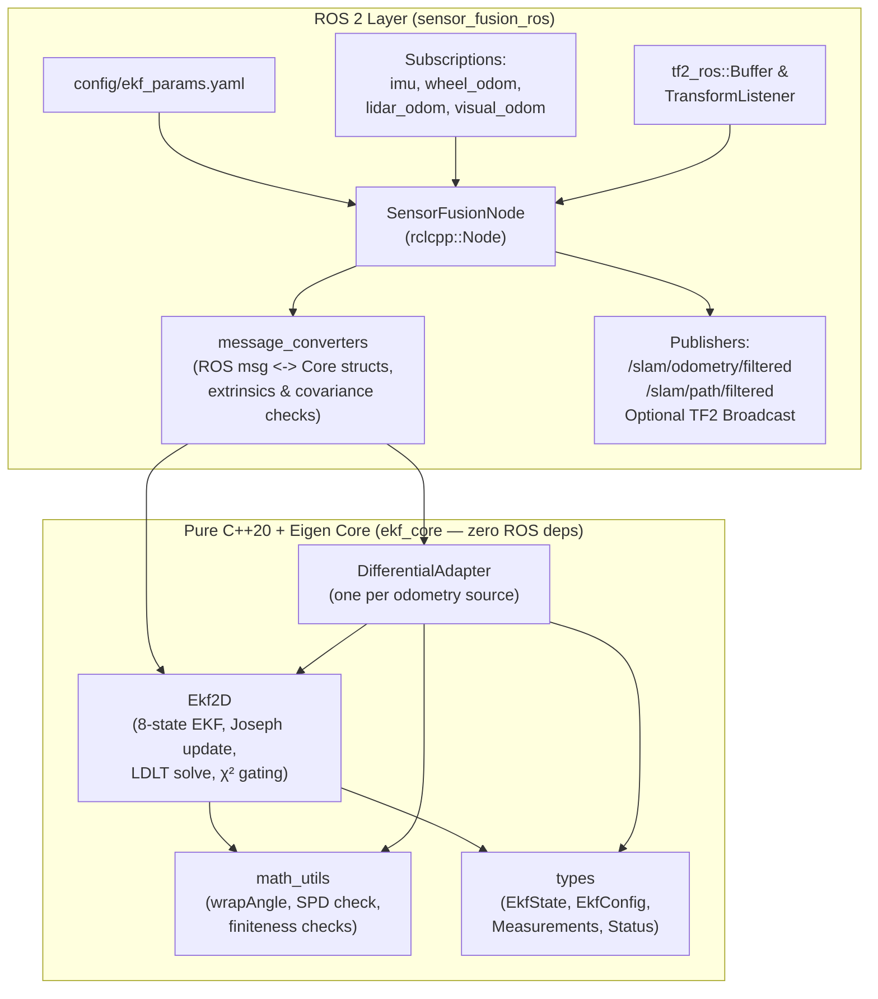

# Sensor Fusion Node Architecture (`slam_sensor_fusion`)

## 1. Purpose & Big Picture

The `slam_sensor_fusion` package provides the ROS 2 Humble sensor fusion node and its underlying pure C++20/Eigen 2D Extended Kalman Filter library (`ekf_core`). It fuses asynchronous inputs from:

- An IMU (`sensor_msgs/msg/Imu`),
- A wheel odometry / IMU-wheel node (`nav_msgs/msg/Odometry`),
- A LiDAR scan matching node (`nav_msgs/msg/Odometry`), and
- A visual odometry node (`nav_msgs/msg/Odometry`),

into a unified filtered state estimate (`nav_msgs/msg/Odometry`), a bounded trajectory (`nav_msgs/msg/Path`), and an optional TF2 transform (`odom -> base_link` or `map -> base_link`).

See [overview.md](overview.md) for the overall vehicle and simulator context, and [ekf_2d.md](../theory/ekf_2d.md) for all mathematical derivations.

---

## 2. Layered Component Architecture

---

## 3. Key Abstractions & State Ownership

### 3.1 Pure C++ Core (`slam_sensor_fusion::core`)
- **`EkfState` (`types.hpp`)**: Value type holding the 8D state vector $\mathbf{x} \in \mathbb{R}^8$, the $8 \times 8$ covariance matrix $P \in \mathbb{R}^{8 \times 8}$, initialization flag, and timestamp in seconds.
- **`EkfConfig` (`types.hpp`)**: Validated configuration struct holding initial covariance diagonal, continuous-rate process noise diagonal $Q_{\text{rate}}$, `min_dt_sec`, `max_dt_sec`, and default Mahalanobis gate thresholds.
- **`Ekf2D` (`ekf_2d.hpp`)**: Stateful, deterministic filter engine. Owns `EkfState` and `EkfConfig`. Exposes:
  - `initialize(state, covariance, timestamp_sec)` / `reset()`
  - `predict(dt_sec)` and `predictTo(timestamp_sec)`
  - `updatePose(Pose2DMeasurement)`
  - `updateTwist(Twist2DMeasurement)`
  - `updateImu(Imu2DMeasurement)`
  - `computeProcessJacobian(x, dt)` / `computeImuJacobian(x)` (exposed for analytical verification tests)
- **`DifferentialAdapter` (`differential_adapter.hpp`)**: Stateful per-sensor converter that tracks a sensor's previous 2D pose and transforms consecutive accumulated poses into body-frame twist measurements (`Twist2DMeasurement`) with rotated covariance. This allows fusing drifting odometry nodes (e.g., LiDAR scan matching + VO) without pose fighting.

### 3.2 ROS 2 Wrapper (`slam_sensor_fusion::ros_node`)
- **`message_converters` (`message_converters.hpp`)**: Pure helper functions converting ROS 2 messages (`Imu`, `Odometry`) into `core` measurement structs, applying optional 2D sensor-to-`base_link` extrinsic transforms, extracting yaw from quaternions safely, removing gravity projection from IMU linear acceleration when enabled, validating incoming 6x6/3x3 covariances with YAML fallback, and populating outgoing `nav_msgs/msg/Odometry` messages.
- **`SensorFusionNode` (`sensor_fusion_node.hpp`)**: Single-threaded `rclcpp::Node` (callbacks serialized by default executor; additionally protected by an internal `std::mutex` for safety under `MultiThreadedExecutor`):
  - Loads and strictly validates all YAML parameters at startup.
  - Subscribes only to enabled sensors using configurable topic names.
  - Queries `tf2_ros::Buffer` (with sanitized frame IDs) to transform measurements from sensor frames (e.g., `velodyne_link`, `zed_link`, `imu_link`) into `base_frame_id` (`base_link`).
  - Applies timestamp policy (clock reset detection, out-of-order handling, `max_dt` clamping/skipping).
  - Publishes filtered odometry, bounded RViz `nav_msgs/msg/Path`, and optional TF transform (`odom_frame_id -> base_frame_id`).
  - Runs a periodic health timer to warn about timed-out sensors and report accepted/rejected update statistics.

---

## 4. Per-Sensor Configuration & Fusion Modes

Every odometry source (`wheel_odom`, `lidar_odom`, `visual_odom`) is configured independently in `config/ekf_params.yaml`:

| `fusion_mode` | What is fused from `nav_msgs/Odometry` | When to use |
| :--- | :--- | :--- |
| `twist` | `twist.twist` $(v_x, v_y, \omega)$ in `base_link` | Best for wheel odometry and any node publishing accurate body-frame velocities. |
| `pose_differential` | Consecutive `pose.pose` differentiated into body-frame $(v_x, v_y, \omega)$ via `DifferentialAdapter` | Best for drifting LiDAR scan matching or visual odometry nodes that only populate `pose` (or whose absolute pose drifts independently). |
| `pose_absolute` | `pose.pose` $(x, y, \theta)$ directly in reference frame | Best for drift-free map-frame localization (e.g., scan-to-map matching) or a single designated global pose reference. |
| `pose_and_twist` | Both `pose.pose` (absolute) and `twist.twist` | Use only when a single source provides globally consistent pose *and* independent velocity measurements. |

For IMU (`imu`), individual measurement channels (`use_yaw`, `use_yaw_rate`, `use_linear_accel`, `compensate_gravity`) are toggled independently in YAML.

---

## 5. Timestamp Policy & Failure Handling

1. **First valid measurement**: Initializes the filter timestamp (and initial pose if the first sensor is an absolute pose source, otherwise starts at origin `(0, 0, 0)` with configured initial covariance).
2. **Normal forward step ($0 < \Delta t \le \Delta t_{\max}$)**: Calls `Ekf2D::predict(dt)` followed by the sensor's `update*()` call.
3. **Zero or minor out-of-order timestamp ($-\tau_{\text{ooo}} \le \Delta t \le 0$)**: Skips prediction and applies the update at the current filter state (increments out-of-order counter). Default $\tau_{\text{ooo}} = 0.05\,\text{s}$.
4. **Stale measurement ($\Delta t < -\tau_{\text{ooo}}$ and $|\Delta t| < \tau_{\text{reset}}$)**: Dropped cleanly with a throttled warning (prevents old delayed data from corrupting current state).
5. **Simulation clock reset ($\Delta t < -\tau_{\text{reset}}$, e.g., $|\Delta t| > 1.0\,\text{s}$)**: Resets the EKF and all `DifferentialAdapter` instances cleanly so Gazebo restarts work seamlessly without restarting the node.
6. **Large positive gap ($\Delta t > \Delta t_{\max}$)**: Subdivides or skips prediction if $\Delta t$ exceeds a safety ceiling (preventing covariance explosion after Gazebo pause/unpause). Specifically, `Ekf2D::predict` sub-steps when $\Delta t$ exceeds `max_substep_dt_sec` and rejects non-finite or unreasonably huge jumps beyond `max_dt_sec`.
7. **Zero / non-SPD incoming covariance**: Automatically substitutes the sensor's YAML fallback covariance and logs a throttled warning.
8. **Outlier spike**: Rejected by Mahalanobis $\chi^2$ gating; filter state and covariance remain untouched and rejection metrics increment.

---

## 6. Design Trade-offs & Future Evolution

- **No State History Rewind Buffer (v1)**: For the initial Nov 29 milestone, out-of-order packets within `out_of_order_tolerance_sec` are applied without rewinding past predictions. If LiDAR/VO processing latency exceeds ~50–100 ms in full-speed driving, a bounded timestamped state/measurement ring buffer (`std::deque`) can be layered inside `SensorFusionNode` without changing `Ekf2D`.
- **Single Reference Frame**: Outputs fused state in `odom_frame_id` (`odom` by default). When global loop-closing SLAM is added later, this node can either serve as the local high-rate `odom -> base_link` estimator or run a second instance in `map` frame following REP-105 dual-EKF architecture.
- **2D to 3D Upgrade Path**: Keeping `core` isolated allows dropping in a 3D `Eskf3D` implementation alongside `Ekf2D` behind the same ROS 2 node pattern if uneven terrain is added in future competitions.

---

## 7. Code Map

| File | Responsibility |
| :--- | :--- |
| `include/slam_sensor_fusion/core/types.hpp` | State indices, `EkfState`, `EkfConfig`, measurement structs, `UpdateResult` |
| `include/slam_sensor_fusion/core/math_utils.hpp` / `src/core/math_utils.cpp` | Angle wrapping, finiteness checks, SPD checks, $\chi^2$ thresholds |
| `include/slam_sensor_fusion/core/ekf_2d.hpp` / `src/core/ekf_2d.cpp` | 2D EKF prediction, analytical Jacobians, Joseph-form updates, gating |
| `include/slam_sensor_fusion/core/differential_adapter.hpp` / `src/core/differential_adapter.cpp` | Consecutive pose differentiation to body twist |
| `include/slam_sensor_fusion/ros/message_converters.hpp` / `src/ros/message_converters.cpp` | ROS 2 message conversion, TF2 extrinsic helpers, covariance fallback |
| `include/slam_sensor_fusion/ros/sensor_fusion_node.hpp` / `src/ros/sensor_fusion_node.cpp` | `rclcpp::Node` orchestration, YAML parameters, pub/sub, health timer |
| `src/ros/main.cpp` | Executable entrypoint (`rclcpp::init` / `spin` / `shutdown`) |
| `config/ekf_params.yaml` | Default deployment parameters matching `shell_urban_simulator` |
| `launch/sensor_fusion.launch.py` | ROS 2 Python launch file with `params_file` and `use_sim_time` |
